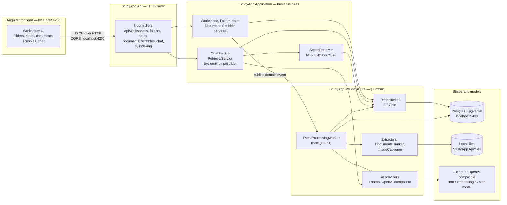
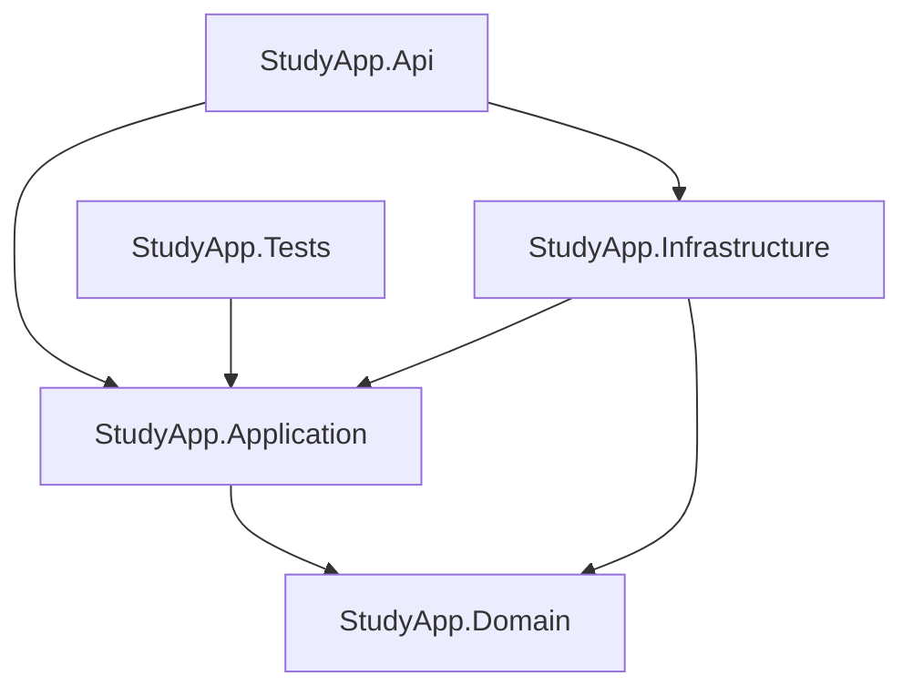
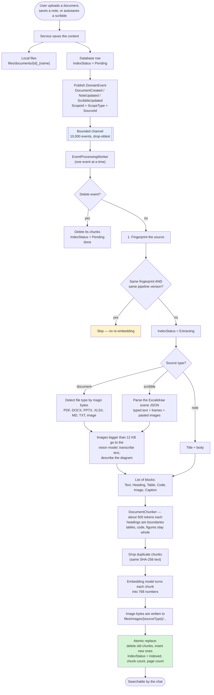
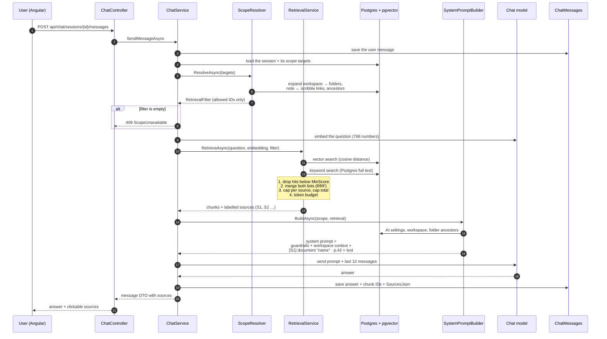
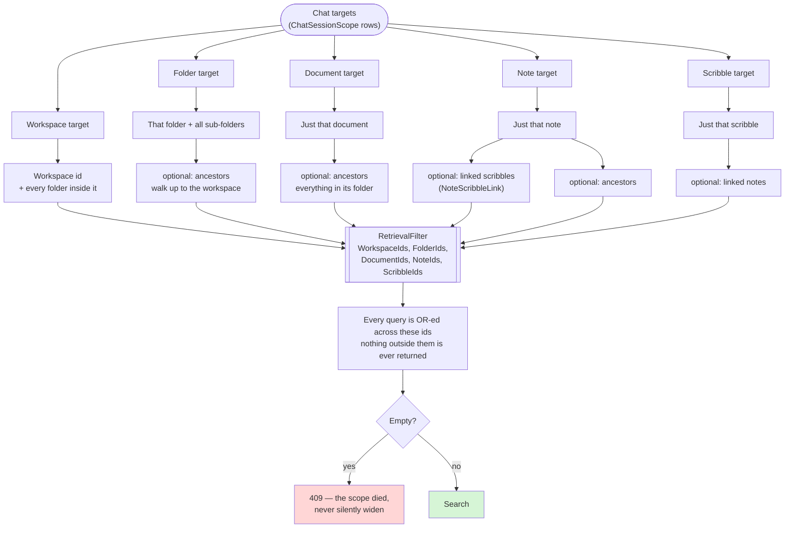
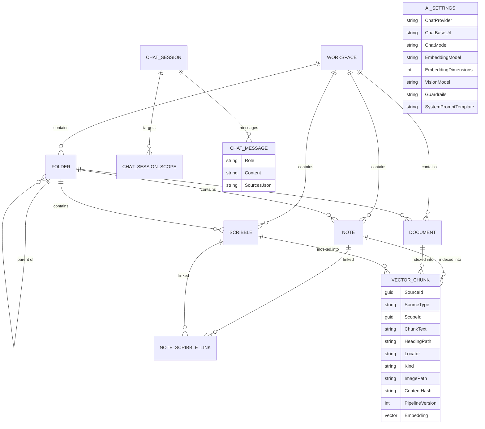

# StudyApp — Entire Project Flow

How the whole system fits together, from a click in the UI to an AI answer.

---

## 1. The big picture

**Rules of the layers (enforced by project references):**

Application never references Infrastructure. That is why it only talks through interfaces
(`IVectorChunkRepository`, `IEmbeddingService`, `IFileStorage`).

---

## 2. Flow A — content comes in (indexing)

Every time you upload a document, save a note, or draw on a scribble, the same background
pipeline runs. The HTTP request returns **immediately**; indexing happens afterwards.

**Why the fingerprint matters:** a scribble autosaves constantly. Without it, every keystroke
would re-run the vision model. It now hashes the *extracted* content, so moving a shape costs
nothing, while editing text does trigger a re-index.

---

## 3. Flow B — a question goes out (chat)

If the model is unreachable the answer is **not** lost — the service stores a plain
"(Assistant unavailable: …)" message instead of throwing, so the chat history stays consistent.

---

## 4. Flow C — scope: what a chat is allowed to see

A chat session can point at several things at once, and each target can be widened.

`GET api/chat/sessions/{id}/scope` returns how many chunks the scope currently resolves to,
which is the fastest way to debug "why does the chat know nothing".

---

## 5. Data model

**One row per chunk, always carrying its own scope** (`ScopeId` + `ScopeType`). That is what
makes filtering cheap: the chat never has to join back to folders to know what is allowed.

`AI_SETTINGS` is a single row. A row saved through the API always beats the `Ai` section in
`appsettings.json`, which only seeds the first read.

---

## 6. API surface

| Area | Routes |
| --- | --- |
| Workspaces | `GET/POST api/workspaces`, `GET/PUT/DELETE api/workspaces/{id}` |
| Folders | `GET/POST api/folders`, `GET/PUT/DELETE api/folders/{id}`, `GET api/folders/{id}/descendants` |
| Notes | `GET/POST api/notes`, `GET/PUT/DELETE api/notes/{id}` |
| Documents | `POST api/documents/upload`, `GET api/documents`, `GET api/documents/{id}/content`, `DELETE api/documents/{id}` |
| Scribbles | `GET/POST api/scribbles`, `GET/PUT/DELETE api/scribbles/{id}`, `POST/DELETE api/scribbles/{id}/link/{noteId}` |
| Chat | `POST api/chat/sessions`, `GET api/chat/sessions`, `GET api/chat/sessions/{id}/scope`, `GET/POST api/chat/sessions/{id}/messages` |
| AI settings | `GET/PUT api/ai/settings`, `POST api/ai/test` |
| Indexing | `POST api/indexing/reindex/{sourceType}/{sourceId}`, `POST api/indexing/reindex` |

Every response is wrapped in the same envelope by `ApiControllerBase` (`ApiResponse<T>`:
success flag, code, message, data). Validation failures return 400 with a field-by-field
dictionary instead of a raw model-state dump.

---

## 7. Where everything lives

```mermaid
flowchart LR
    subgraph L1["StudyApp.Api"]
        A1["Controllers/"]
        A2["Program.cs — DI, CORS, OpenTelemetry"]
        A3["files/ — uploaded documents and extracted images"]
    end

    subgraph L2["StudyApp.Application"]
        B1["Workspaces, Folders, Notes,<br/>Documents, Scribbles — services + DTOs"]
        B2["Chat/ — ChatService, prompt builder"]
        B3["Retrieval/ — options + hybrid search"]
        B4["Scoping/ — ScopeResolver, RetrievalFilter"]
        B5["Embeddings/ — pipeline version, block model"]
        B6["Repositories/ — interfaces only"]
    end

    subgraph L3["StudyApp.Domain"]
        C1["Entities/ — Workspace, Folder, Note,<br/>Document, Scribble, VectorChunk,<br/>ChatSession, ChatMessage, AiSettings"]
        C2["Enums/"]
    end

    subgraph L4["StudyApp.Infrastructure"]
        D1["Repositories/ — EF Core implementations"]
        D2["Embeddings/ — TextExtractor, DocumentChunker,<br/>readers/ (PDF, OpenXml, Spreadsheet,<br/>Markdown, ScribbleCanvas)"]
        D3["Ai/ — Ollama + OpenAI-compatible<br/>chat, embedding, vision"]
        D4["Events/ — channel publisher + worker"]
        D5["Migrations/"]
    end

    L1 --> L2
    L1 --> L4
    L4 --> L2
    L2 --> L3
    L4 --> L3
```

---

## 8. Two things this diagram does *not* show yet

1. **No authentication or authorisation.** Every route is open. `Workspaces.OwnerUserId`
   exists but is never read. There is no user identity anywhere in the flow, so "scope"
   currently means "what this chat points at", not "what this person is allowed to see".
2. **No Mermaid module.** The planned diagram feature (turning study material into Mermaid
   charts) is not in the pipeline yet; it would plug in as a separate step after retrieval.
