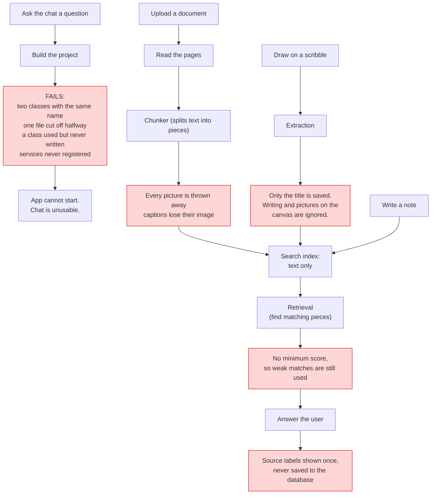
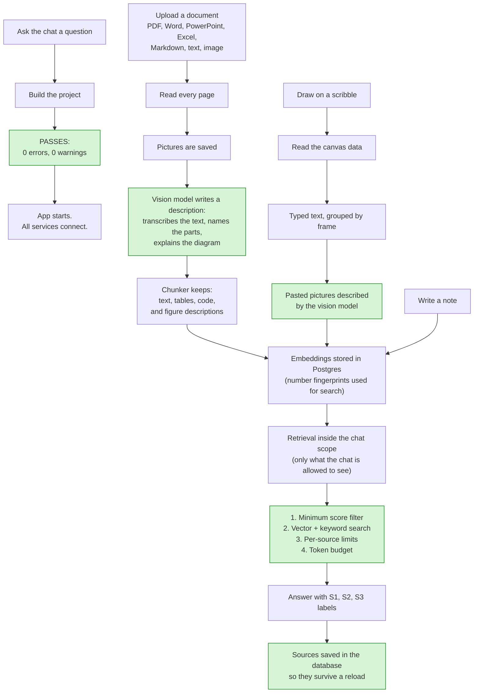

# What Changed — Simple Explanation

This file explains, in plain English, what was broken in the project and what was fixed.
It also shows a picture of how the app worked **before** and how it works **now**.

---

## The short version

The code for all the new features had been written, but the project **did not build**.
So none of it could actually run.

Several files had small mistakes (a class written twice, a file that was cut off halfway,
a class that was used but never created). A few other things were "wired up wrong" — pieces
existed but were never connected, so even after the project built, the features would not
have worked properly.

All of that is now fixed:

- **Build:** 0 errors, 0 warnings
- **App:** starts successfully and all services connect
- **Database:** still needs to be switched on (see "What is still missing")

---

## What was wrong (in plain English)

### Things that stopped the project from building

| Problem | What it means |
| --- | --- |
| Two classes named `VisionModelConfig` | We had the same recipe written in two places. C# refuses to build until one is removed. |
| Two files named `ImageCaptioner` | Same thing — two identical copies of one class. Only one is allowed. |
| `ScribbleCanvasExtractor.cs` was cut off | The file stopped in the middle of a sentence, like a page torn in half. C# could not read it. |
| `ICaptioner` was used but does not exist | The code called a helper by the wrong name. The real name is `IImageCaptioner`. |
| `OpenAiCompatibleVisionProvider` was registered but never written | The app says "I will use this" but the class was never created. |

### Things that were wired up wrong (would have failed at runtime)

| Problem | What it means |
| --- | --- |
| Four services were never registered | The app knows how to build these parts but was never told to. Asking for them = crash. This also stopped the database tooling from working. |
| `MinScore` (minimum-score option) existed but was never used | We had a "reject weak matches" setting that nothing read, so weak matches still got used. |
| The chunker threw away every picture | Pictures were read, then silently dropped before saving. The chat could never see them. |
| Captions lost their picture | Even when the vision model described a picture, the picture itself was not saved with the description. |
| Scribbles only saved the title | The drawing on the canvas was never read. A scribble was almost invisible to the chat. |
| Scribble "did anything change?" check was wrong | It compared the raw drawing data, so **moving a box** made it re-index the whole scribble. Slow and wasteful. |
| Chat sources were never saved | The answer showed `S1`, `S2` once. Reload the chat and they were gone. |
| PowerPoint page count was wrong | It counted text blocks instead of slides. |

---

## Before and after at a glance

| Area | Before | After |
| --- | --- | --- |
| Build | Failed with many errors | Clean: 0 errors, 0 warnings |
| App start | Could not start | Starts, all services resolve |
| PDF / Word / Excel / Markdown | Read text only | Same, plus pictures are described and saved |
| Pictures inside documents | Dropped before indexing | Saved, described, and searchable |
| Scribbles | Only the title | Canvas text grouped by frame + pasted pictures described |
| Strong-match filter | Setting existed but unused | Applied before results are merged |
| Answer sources | Shown once, then lost | Saved in the database, survive reload |
| Scribble re-indexing | Every tiny canvas move | Only when the actual content changes |
| Database schema | Phase 4 columns did not exist | Phase 4 migration created; all 3 migrations still need to be applied |

---

## Diagram 1 — HOW IT WORKED BEFORE

Red boxes are the broken parts.

---

## Diagram 2 — HOW IT WORKS NOW

Green boxes are what is new or repaired.

---

## What the words mean

- **Chunk** — a small piece of a document. We split big files into pieces so the chat can find the right part.
- **Embedding** — a list of numbers that represents meaning. Similar sentences get similar numbers.
- **Retrieval** — the app searches those numbers and finds the pieces that best match the question.
- **Scope** — the limit on what a chat can see. A chat about one note cannot read your whole workspace.
- **Fingerprint** — a short code made from content. If the fingerprint is the same, the content has not changed, so we skip re-indexing.
- **Vision model** — an AI model that can look at a picture and describe it in words.

---

## Files that were touched

**Deleted**

- `StudyApp.Infrastructure/Ai/ImageCaptioner.cs` (duplicate copy)

**Created**

- `StudyApp.Infrastructure/Ai/OpenAiCompatibleVisionProvider.cs`
- `StudyApp.Infrastructure/Migrations/20261022103113_Phase4RetrievalAndVision.cs`

**Fixed**

- `StudyApp.Application/Ai/IVisionProvider.cs` — removed the duplicate config class
- `StudyApp.Infrastructure/Embeddings/Readers/ScribbleCanvasExtractor.cs` — completed the cut-off file
- `StudyApp.Infrastructure/Embeddings/TextExtractor.cs` — correct interface name, real scribble reading, caption handling
- `StudyApp.Infrastructure/Embeddings/DocumentChunker.cs` — pictures are no longer dropped
- `StudyApp.Infrastructure/Embeddings/Readers/OpenXmlTextExtractor.cs` — slide count and null safety
- `StudyApp.Application/Retrieval/RetrievalService.cs` — minimum score is now applied
- `StudyApp.Application/Chat/ChatService.cs` — sources are saved and read back
- `StudyApp.Api/Program.cs` — the four missing service registrations

---

## What is still missing

1. **The database is not running.** Nothing will work until Postgres is started on port `5433`
   and the three migrations are applied. Docker was not available on the machine, so this
   step could not be done here.
2. **Login and security (Phase 7) does not exist yet.** There is no sign-in, no permission
   checks, no multi-factor authentication. The `OwnerUserId` column is prepared but never used.
3. **Notes re-index every time you save them.** Notes have no "has this changed?" marker,
   so they are re-processed on every save. Works, but wasteful.
4. **Vision settings cannot be changed yet.** The database has columns for a separate vision
   model, but the settings screen does not expose them, so pictures use your normal chat model.
